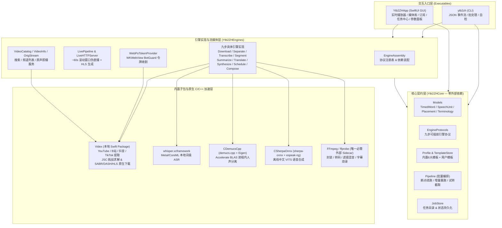

# ytb2zh 项目文档中心（Human & AI Context Guide）

> **一句话定位**：`ytb2zh` 是一个纯 Swift 编写的 macOS 客户端与命令行工具，负责将**英文（外语）视频全自动转换为中文字幕 + 中文配音成片**，并提供约 4x 实时处理速度的**「边处理边看」追赶式伪直播播放器**。

本文档体系专为**人类开发者**与**AI 编程助手（Agent）**共同设计：通过清晰的 Mermaid 架构图、数据流转图、算法公式与精确到源文件的索引表，让你在数分钟内建立完整的项目心智模型。

---

## 📚 文档导航

| 文档 | 核心内容 | 适用场景 |
| :--- | :--- | :--- |
| **[01. 系统架构与模块设计](architecture.md)** | SwiftPM 包分层、依赖倒置机制、核心数据模型（`Models.swift`）、任务状态机与目录规范（`JobStore`） | 理解项目分层、查找数据定义、了解任务持久化与断点续跑机制 |
| **[02. 九步译配管线与核心算法](pipeline-and-algorithms.md)** | 九步引擎矩阵、标点/LLM 语义切分、三步翻译与字数节奏控制、子句拆分、**漂移上限对齐调度（DriftScheduler）**、FFmpeg 混音与 Netflix 字幕生成 | 修改翻译 Prompt、调整配音时间轴对齐算法、修改字幕切分或混音滤镜 |
| **[03. 实时伪直播与 Videx 提取引擎](live-streaming-and-videx.md)** | 追赶式 HLS 伪直播管线（`LivePipeline`）、`ytb2zh-live://` 零网络直读、原声流服务、**Videx 纯 Swift 四站点提取与原生下载**、WKWebView Web PO Token 收割 | 排查视频解析/下载 403 风控、理解边译边播原理、维护 YouTube/B站/抖音/TikTok 提取器 |
| **[04. CLI、GUI 与二次开发指南](cli-gui-and-development.md)** | CLI 命令与 JSON 事件流协议、Profile 模板体系、SwiftUI GUI 页面状态流、i18n/日志系统、**3 步新增自定义引擎指南**与测试矩阵 | 日常使用 CLI/GUI、编写自动化脚本、新增 TTS/ASR/LLM 引擎插件、运行单测与真机校验 |
| **[05. S2ST 端到端语音翻译调研](s2st-调研.md)** | 端到端语音到语音翻译（S2ST）云 API 与开源模型对比、与现有级联管线的权衡与演进路线 | 探索下一代端到端配音引擎演进方向 |

---

## 🗺 全景架构速览



---

## 📂 仓库代码地图（AI 快速索引）

当需要定位或修改特定功能时，请直接按以下映射表查找对应源码：

### 1. 核心契约层：`Sources/Ytb2ZHCore/`
> **约束**：纯模型、协议与流程编排，**严禁引入任何具体引擎、网络客户端或 C/C++ 库依赖**。

| 文件路径 | 核心职责与关键类型 |
| :--- | :--- |
| `Sources/Ytb2ZHCore/Models.swift` | 定义贯穿全管线的数据结构：`TimedWord`、`SpeechUnit`、`Clause`、`Placement`、`UnitSchedule`、`TerminologyExtraction`、`StepID`（九步枚举）、`PipelineEvent` |
| `Sources/Ytb2ZHCore/EngineProtocols.swift` | 定义九步引擎协议（`DownloadEngine`、`VocalSeparationEngine`、`TranscribeEngine`、`SegmentationEngine`、`TerminologyEngine`、`TranslateEngine`、`SpeechSynthesisEngine`、`SchedulerEngine`、`CompositionEngine`）及 `EngineDescriptor` |
| `Sources/Ytb2ZHCore/Profile.swift` | 定义各步 `Options` 配置结构、`Profile` 实体、6 个内置场景模板（`balanced`/`tightSync`/`relaxed`/`subtitlesOnly`/`studied`/`keepBGM`）及 `TemplateStore` |
| `Sources/Ytb2ZHCore/JobStore.swift` | 管理任务目录（`~/Library/Application Support/Ytb2ZH/Jobs/<id>/`）、各步状态（`pending`/`running`/`done`/`failed`）、产物路径约定及 `EngineRegistry` |
| `Sources/Ytb2ZHCore/Pipeline.swift` | 批量九步管线编排器、断点续跑判定、试转截取（`TrialTrim`）、中文子句智能拆分器（`ClauseTextSplitter`） |

### 2. 引擎与流媒体层：`Sources/Ytb2ZHEngines/`

| 领域 | 文件路径 | 核心职责 |
| :--- | :--- | :--- |
| **引擎装配** | `EngineAssembly.swift` | 注册所有可用引擎描述符，根据 `Profile.engines` 实例化 `EngineSet` |
| **下载与提取** | `VidexBridge.swift` | 桥接内置 `Videx` 库（提取、原生下载、格式选择、原声流选取、WebPO 注入与风控回退） |
| | `DownloadTranscribe.swift` | `SmartDownloadEngine`（Videx 优先 → yt-dlp 兜底 → 本地文件导入）、`YtDlpDownloadEngine`、`WhisperCliEngine` |
| | `FileDownloadEngines.swift` | `FileImportEngine` 本地媒体文件直接拷入任务目录 |
| | `YtDlpInstaller.swift` | 当内置提取失败时，按需从官方 GitHub Releases 自动下载 `yt-dlp_macos` 到 `~/.ytb2zh/bin/` |
| | `WebPoTokenProvider.swift`<br/>`WebPoTokenScripts.swift` | 使用隐藏 `WKWebView` 在真实 `youtube.com` 环境运行 BotGuard 收割 `visitorData` + `poToken`（缓存于 `~/.ytb2zh/pot/`） |
| **人声分离** | `DemucsVocalSeparator.swift` | 调用 `CDemucsCpp` 在进程内执行 `htdemucs` 人声/伴奏分离，产出 `vocals.wav` 与 `instrumental.wav` |
| **语音识别** | `NativeWhisperEngine.swift` | 调用内置 `whisper.xcframework`（Metal 加速）执行词级时间戳转录 |
| | `SrtImportEngine.swift` | 外部 `.srt` 字幕导入引擎（跳过 ASR，直接按句生成伪词级时间戳进入切分） |
| **语义切分** | `PunctSegmentationEngine.swift` | 英文句读规则切分（含缩写/小数句界消歧、逗号 7s 软窗口、13s 硬窗口、无标点尾句确定性合并） |
| | `LLMSegmentationEngine.swift` | 在 `punct` 粗切基础上调用 LLM 按完整语义二次重组 |
| **术语与翻译** | `TerminologyEngines.swift` | `GatewayTerminologyEngine` 扫描全文提取领域语境（`DomainContext`）与专业术语表（`terminology.json`） |
| | `TranslateCore.swift` | 翻译核心：并发批次调度、领域/术语注入、VideoLingo 三步翻译（直译→反思→意译）、4字/秒双向字数预算与超短句定向扩写 |
| | `GatewayTranslateEngine.swift`<br/>`OpenAICompatTranslateEngine.swift` | 分别对接 Responses API 网关与标准 OpenAI `/v1/chat/completions` 接口 |
| **语音合成** | `BailianSynthEngine.swift` | 阿里云百炼 CosyVoice / Qwen-Audio WebSocket 语音合成 |
| | `EdgeTTSSwift.swift` | 纯 Swift WebSocket 直连微软 Edge 在线 TTS（支持 SSML 语速控制与代理） |
| | `AlternateTTSEngines.swift` | `OpenAITTSEngine`（`/v1/audio/speech`） |
| | `LocalTTSEngines.swift` | `LocalSayTTSEngine`（macOS `say`）与 `SherpaOnnxTTSEngine`（内嵌 `CSherpaOnnx` 离线中文 VITS） |
| **对齐与合成** | `DriftSchedulerEngine.swift` | 核心漂移上限调度器（控制配音提前/落后上限、子句停顿扩充、语速 `atempo` 折算） |
| | `FFmpegComposeEngine.swift` | 配音轨拼接、`SRTBuilder`（Netflix 单行字幕标准 + 双语字幕）、BGM/原声闪避混音与视频硬字幕烧录 |
| **实时伪直播** | `LivePipeline.swift`<br/>`LiveHTTPServer.swift` | 追赶式伪直播编排（全篇转录切分 + 60s 窗口滚动翻译/合成/调度/TS 切片 + EVENT m3u8 生成） |
| **搜索与原声** | `VideoCatalogService.swift`<br/>`VideoInfoService.swift`<br/>`OrigStreamService.swift`<br/>`OrigStreamServer.swift` | 搜索/频道/播放列表解析、视频详情获取、原声播放流反代服务 |
| **模型与工具** | `ModelStore.swift`<br/>`MediaCompat.swift`<br/>`ProcessRunner.swift` | 模型自动下载管理（`~/.ytb2zh/models/`）、媒体容器兼容性探测、外部子进程安全执行器 |

### 3. 内置视频提取库：`Videx/`
- `Videx/Sources/Videx/Core/`：站点无关的 `Extractor` 协议、`MediaInfo`/`MediaFormat` 模型、`FormatSelector`、HTTP/Cookie/浏览器 Cookie 解密、JavaScriptCore 运行时、原生下载器（`NativeMediaDownloader` / `NativeHLSDownloader` / `NativeDASHLiveDownloader`）。
- `Videx/Sources/Videx/YouTube/`：InnerTube 多客户端轮询、JSC `NativeEJSSolver` 签名/n参数解密、`SABRDownloader`（UMP/Protobuf 流下载）、HLS/DASH 解析器、原生搜索服务。
- `Videx/Sources/Videx/Bilibili/`、`Douyin/`、`TikTok/`、`Aweme/`：B站 WBI 签名与 DASH 提取、抖音 `ttwid` 注册与详情解析、TikTok Slardar WAF PoW 原生 SHA-256 求解。

### 4. 客户端入口：`Sources/ytb2zh/` & `Sources/Ytb2ZHApp/`
- `Sources/ytb2zh/`：命令行入口（`CLI.swift`、`VerifyCommand.swift`、`OrigProbe.swift`、`TTSProbe.swift`）。
- `Sources/Ytb2ZHApp/`：SwiftUI 桌面端（`Ytb2ZHApp.swift` 主导航、`LivePlayerView.swift` 实时/原声播放器、`LibraryView.swift` 媒体库、`SubscriptionStore.swift` 订阅预翻译、`ParameterPanel.swift` 参数面板、`JobCenter.swift` & `JobDetailView.swift` 任务中心与译文/术语编辑器、`AppSettingsView.swift` 设置页、`L10n.swift` 国际化、`AppLog.swift` 环形日志）。

---

## 💾 本地文件系统布局全貌

项目在运行期间仅使用以下两个标准目录存储数据、缓存与模型：

```text
~/Library/Application Support/Ytb2ZH/
├── Jobs/                                # 任务产物根目录（可在设置中通过 customJobRoot 自定义）
│   └── <timestamp>-<uuid6>/             # 单个任务目录（批量与直播共用同构目录）
│       ├── status.json                  # 各步骤状态 (pending/running/done/failed) 与 URL/模板名
│       ├── profile.json                 # 任务创建时的完整 Profile 参数快照
│       ├── log.txt                      # 管线运行日志（跨续跑追加）
│       ├── source.mp4                   # 下载的原始视频（或 .webm/.mkv）
│       ├── trial_source.mp4             # 试转模式截取的前 N 秒视频（仅试转任务）
│       ├── vocals.wav                   # [可选] Demucs 分离出的人声轨
│       ├── instrumental.wav             # [可选] Demucs 分离出的伴奏轨（供 BGM 混入）
│       ├── audio16k.wav                 # 供 Whisper 转录的 16kHz 单声道 WAV
│       ├── words.json                   # Step 3 产物：[TimedWord] 词级时间戳
│       ├── units.json                   # Step 4 产物：[SpeechUnit] 英文语义单元
│       ├── terminology.json             # [可选] Step 5 产物：DomainContext + [TerminologyTerm]
│       ├── translated.json              # Step 6 产物：带中文译文与音色的 [SpeechUnit]
│       ├── clauses/                     # Step 7 产物：子句 TTS 缓存（1.0x 语速）
│       │   ├── u0_c0.mp3                # 第 0 单元第 0 子句音频
│       │   ├── u0_c0.duration           # 伴生精确时长缓存（避免重复 ffprobe）
│       │   └── rate@1.2/                # 非 1.0x 语速独立子目录（改语速不污染旧缓存）
│       ├── plan.json                    # Step 8 产物：SchedulePlan (placements + unitSchedules)
│       ├── dub.wav                      # Step 9 中间产物：拼接对齐后的完整中文配音轨
│       ├── zh.srt                       # Step 9 产物：对齐后的中文字幕（或中英双语字幕）
│       ├── final_zh.mp4                 # Step 9 终局产物：烧录字幕+替换配音的最终成片
│       └── live/                        # [仅实时播放] HLS 伪直播工作目录
│           ├── live.m3u8                # EVENT 型 HLS 播放列表
│           └── seg000.ts ...            # 按 ~60s 窗口生成的 MPEG-TS 分片
├── Templates/                           # 用户自定义保存的 Profile 模板 (*.json)
├── Subscriptions.json                   # 订阅的频道/播放列表及已处理视频记录
└── PlaybackHistory.json                 # 媒体库观看进度记录

~/.ytb2zh/
├── models/                              # 自动按需下载的本地推理权重
│   ├── ggml-base.en.bin                 # Whisper 语音识别模型
│   ├── vits-zh-hf-theresa/              # Sherpa-ONNX 离线中文 TTS 模型目录
│   └── ggml-model-htdemucs-4s-f16.bin   # Demucs.cpp 人声分离权重
├── bin/
│   └── yt-dlp_macos                     # 按需自动下载的备用 yt-dlp 二进制（默认不下载）
├── pot.json                             # 最近一次 Web PO Token 快照（供 UI 状态展示）
└── pot/
    └── <scope-sha256>.json              # 按 (videoID + proxy + cookies) 隔离缓存的 PO Token
```
