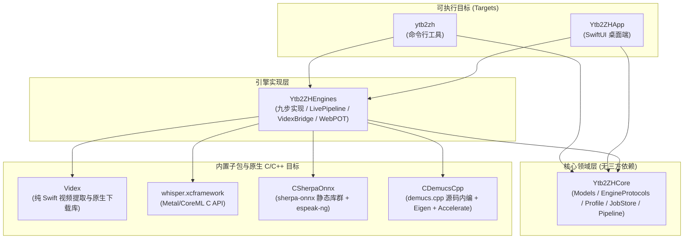
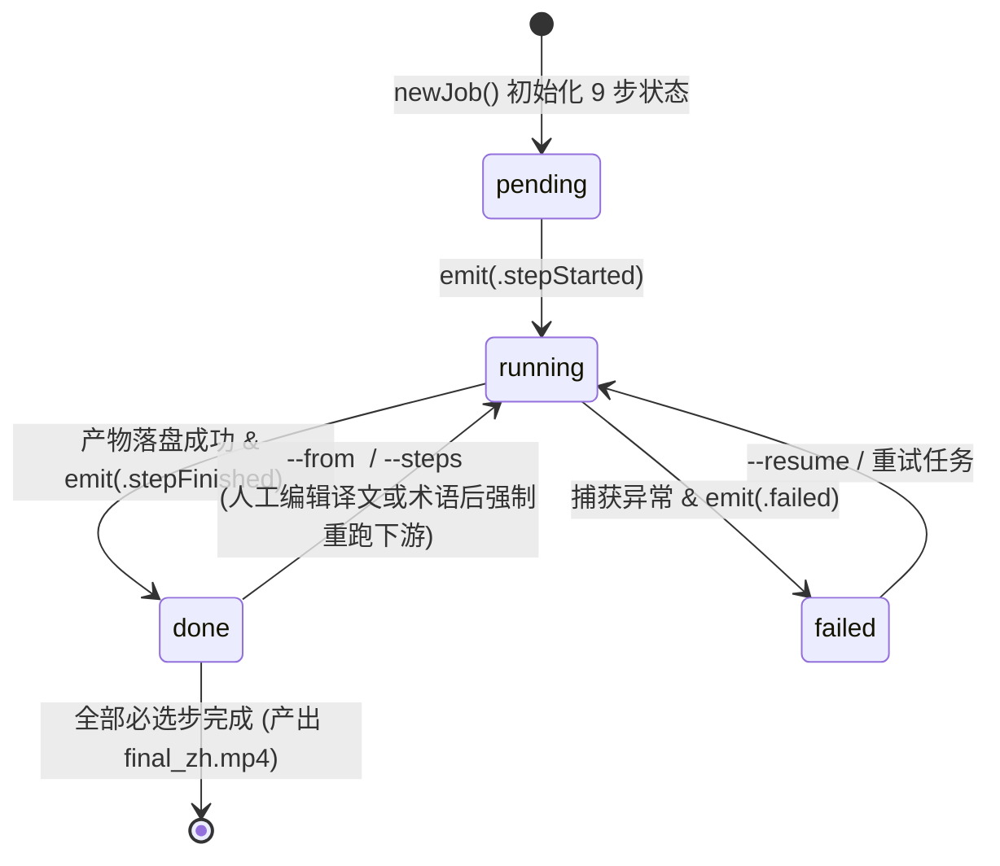

# 01. 系统架构与模块设计（Architecture & Modules）

本文档阐述 `ytb2zh` 的包依赖结构、依赖倒置（DIP）插件架构、核心领域模型，以及任务持久化与断点续跑状态机。

---

## 1. SwiftPM 模块与依赖分层

项目采用 **Swift 6.0** 构建（最低支持 `macOS 14`），通过 `Package.swift` 划分为清晰的四层架构，并内嵌本地提取包 `Videx` 与三个 C/C++ 原生推理模块：



### 分层设计原则
1. **`Ytb2ZHCore` 零污染**：只包含领域数据结构（`Models.swift`）、九步抽象协议（`EngineProtocols.swift`）、配置模型（`Profile.swift`）、任务落盘约定（`JobStore.swift`）和纯协议编排器（`Pipeline.swift`）。这使得核心逻辑可以脱离网络、FFmpeg 和大模型高速运行单元测试。
2. **依赖倒置（Dependency Inversion）**：`Pipeline` 接收 `EngineSet`（全部由 `any xxxEngine` 协议组成）。新增或替换任何一步的实现（例如将翻译从 Gateway 换成 OpenAI Compat，或将 TTS 从百炼换成离线 Sherpa-ONNX），只需在 `Ytb2ZHEngines/EngineAssembly.swift` 注册即可，`Pipeline` 与 GUI/CLI 无需改动。
3. **All-in-One 原生内嵌**：
   - **ASR**：`whisper.xcframework` 进程内直连，启用 Apple Silicon Metal 加速；
   - **人声分离**：`CDemucsCpp` 将 `demucs.cpp` 与 Eigen 源码内编，链接 macOS `Accelerate.framework` BLAS；
   - **离线 TTS**：`CSherpaOnnx` 静态链接 `sherpa-onnx`、`onnxruntime`、`espeak-ng` 与 `piper_phonemize`；
   - **在线免费 TTS**：`EdgeTTSSwift.swift` 纯 Swift WebSocket 直连微软端点；
   - **视频提取与下载**：内置 `Videx` 纯 Swift 包完成解析与分片下载，**FFmpeg 是唯一必需的外部命令行工具**（用于音频重采样、滤镜混音与字幕烧录）。

---

## 2. 九步协议契约与装配机制

`Sources/Ytb2ZHCore/EngineProtocols.swift` 将视频译配拆解为 **9 个标准步骤（`StepID`）**，其中第 2 步（人声分离 `separate`）和第 5 步（术语提取 `summarize`）为可选步（默认 `none`）：

```mermaid
classDiagram
    class EngineSet {
        +DownloadEngine downloader
        +VocalSeparationEngine? separator
        +TranscribeEngine transcriber
        +SegmentationEngine segmenter
        +TerminologyEngine? terminologist
        +TranslateEngine translator
        +SpeechSynthesisEngine synthesizer
        +SchedulerEngine scheduler
        +CompositionEngine composer
    }

    class DownloadEngine {
        <<protocol>>
        +EngineDescriptor descriptor
        +download(url, to, options, progress) URL
    }
    class VocalSeparationEngine {
        <<protocol>>
        +EngineDescriptor descriptor
        +separate(video, workDir, options, progress) (vocals, instrumental)
    }
    class TranscribeEngine {
        <<protocol>>
        +EngineDescriptor descriptor
        +transcribe(video, workDir, options, progress) [TimedWord]
    }
    class SegmentationEngine {
        <<protocol>>
        +EngineDescriptor descriptor
        +segment(words, options) [SpeechUnit]
    }
    class TerminologyEngine {
        <<protocol>>
        +EngineDescriptor descriptor
        +extractTerms(units, options, progress) TerminologyExtraction
    }
    class TranslateEngine {
        <<protocol>>
        +EngineDescriptor descriptor
        +translate(units, options, progress) [SpeechUnit]
    }
    class SpeechSynthesisEngine {
        <<protocol>>
        +EngineDescriptor descriptor
        +Bool supportsRateControl
        +synthesize(text, cacheKey, cacheDir, options) (url, duration)
    }
    class SchedulerEngine {
        <<protocol>>
        +EngineDescriptor descriptor
        +schedule(units, clauseDurations, options) SchedulePlan
    }
    class CompositionEngine {
        <<protocol>>
        +EngineDescriptor descriptor
        +compose(video, placements, unitSchedules, units, cacheDir, output, options, progress) URL
    }

    EngineSet --> DownloadEngine
    EngineSet --> VocalSeparationEngine
    EngineSet --> TranscribeEngine
    EngineSet --> SegmentationEngine
    EngineSet --> TerminologyEngine
    EngineSet --> TranslateEngine
    EngineSet --> SpeechSynthesisEngine
    EngineSet --> SchedulerEngine
    EngineSet --> CompositionEngine
```



### 引擎发现与校验（`EngineRegistry` & `EngineAssembly`）
- 每个引擎实现类都提供一个 `EngineDescriptor(id, name, detail)`。
- `EngineAssembly.registry()` 汇总所有步骤的可用引擎列表：
  - **CLI** 通过 `ytb2zh providers` 直接打印该注册表；
  - **GUI** 在参数面板中读取该注册表动态生成下拉选择器；
  - **执行前校验**：`EngineRegistry.validate(profile:)` 会在管线启动前校验 `Profile.engines` 中配置的每一步 `id` 是否合法。

---

## 3. 核心领域数据模型流转

从原始视频到最终成片，数据在九步之间通过强类型 Swift `Codable` 结构体（定义于 `Sources/Ytb2ZHCore/Models.swift`）流转并落盘为 JSON：

```mermaid
flowchart LR
    Video["source.mp4<br/>(原始视频)"] -->|1. Download| Video
    Video -->|2. Separate (可选)| Audio["vocals.wav +<br/>instrumental.wav"]
    Video & Audio -->|3. Transcribe| Words["words.json<br/>[TimedWord]"]
    Words -->|4. Segment| Units["units.json<br/>[SpeechUnit (en)]"]
    Units -->|5. Summarize (可选)| Terms["terminology.json<br/>TerminologyExtraction"]
    Units & Terms -->|6. Translate| TransUnits["translated.json<br/>[SpeechUnit (en+zh+voice)]"]
    TransUnits -->|ClauseTextSplitter| Clauses["[Clause]<br/>子句列表"]
    Clauses -->|7. Synthesize| ClauseMP3["clauses/u{i}_c{k}.mp3<br/>+ .duration"]
    TransUnits & ClauseMP3 -->|8. Schedule| Plan["plan.json<br/>SchedulePlan"]
    Video & Audio & ClauseMP3 & Plan -->|9. Compose| Final["final_zh.mp4 +<br/>zh.srt"]
```

### 关键模型数据结构速查

| 结构体 | 所在阶段 | 关键字段与语义 |
| :--- | :--- | :--- |
| `TimedWord` | 转录输出 (`words.json`) | `start: Double`, `end: Double`, `text: String` — 词级时间戳，是后续按英文句读精准切分的基础。 |
| `SpeechUnit` | 切分输出 (`units.json`)<br/>翻译输出 (`translated.json`) | `start: Double`, `end: Double`, `en: String`, `zh: String`, `voice: String?` — 语义完整的一句话。`voice` 支持按单元覆盖音色（多角色配音）。 |
| `TerminologyExtraction` | 术语提取输出 (`terminology.json`) | `domain: DomainContext?`（含 `domain`/`tone`/`audience`）+ `terms: [TerminologyTerm]`（含 `en`/`zh`/`note`）。向后兼容旧版纯数组 JSON。 |
| `Clause` | 合成与调度内部 | 由 `ClauseTextSplitter` 将 `SpeechUnit.zh` 按中文停顿标点拆出的自然连读子句，是 TTS 合成与停顿调节的最小粒度。 |
| `Placement` | 调度输出 (`plan.json`) | `unitIndex: Int`, `clauseIndex: Int`, `text: String`, `at: Double`（新时间轴起点）, `duration: Double`（变速后时长）, `atempo: Double`（FFmpeg 变速倍率）。 |
| `UnitSchedule` | 调度输出 (`plan.json`) | `unitIndex: Int`, `originalStart: Double`, `originalEnd: Double`, `newStart: Double`, `newEnd: Double`, `lead: Double`（`originalStart - newStart`，正数表示配音提前）。用于生成对齐后的 SRT 字幕与同步质量统计。 |
| `SchedulePlan` | 调度输出 (`plan.json`) | 汇总 `placements`、`unitSchedules` 及全局指标 `maxLead`、`meanLead`、`interUnitWait`、`totalDuration`。 |

---

## 4. Profile 模板与向后兼容设计

`Profile`（定义于 `Sources/Ytb2ZHCore/Profile.swift`）封装了一次转换所需的全部引擎选择与参数：

- **9 步引擎字典**：`engines: [String: String]`（键为 `StepID.rawValue`，值为引擎 `id`）。
- **9 组参数结构体**：`DownloadOptions`、`SeparationOptions`、`TranscribeOptions`、`SegmentationOptions`、`TerminologyOptions`、`TranslateOptions`、`SynthOptions`、`ScheduleOptions`、`ComposeOptions`。
- **运行时瞬态字段隔离**：
  - `DownloadOptions.partialSeconds`（试转秒数）与 `TranslateOptions.terminology` / `domain`（由 `terminology.json` 运行时注入）在自定义 `encode(to:)` 中被显式排除，**永不写入模板 JSON**，防止污染用户保存的模板。
- **防御式解码（向后兼容）**：
  - 所有 `Options` 与 `Profile` 均实现了自定义 `init(from decoder: Decoder)`，使用 `decodeIfPresent` 配合默认值兜底，并用 `Profile.defaultEngines.merging(storedEngines)` 合并引擎字典。即使加载旧版本（如 7 步管线时期或缺少新字段）的 `profile.json` 或用户模板，也能平滑升级不报错。

---

## 5. JobStore 与断点续跑状态机

`JobStore`（`Sources/Ytb2ZHCore/JobStore.swift`）通过文件系统实现任务的持久化、断点续跑与增量重跑，无需数据库：



### 断点续跑与缓存复用规则
1. **产物存在性优先 + `stepFilter` 强制覆盖**：
   - 在 `Pipeline.run()` 中，当 `stepFilter` 未强制指定重跑某步时，只要磁盘上已有该步的有效产物（如 `words.json`、`units.json`、`translated.json`），即直接反序列化复用。
2. **子句级 TTS 幂等缓存（按语速隔离）**：
   - 语音合成按 `u{unitIndex}_c{clauseIndex}.mp3` 缓存在 `clauses/` 目录下（伴生 `.duration` 文件记录精确时长，时长 `< 0.35s` 的异常静音自动视为未命中）。
   - 当用户调整合成语速（`synth.rate != 1.0`）时，`JobStore.clauseCache(_:rate:)` 会自动路由到 `clauses/rate@1.2/` 子目录，**修改语速绝不污染 1.0x 原速缓存**。
3. **人工修订闭环**：
   - 用户在 GUI「任务中心」修改 `terminology.json` 或 `translated.json`（含单句音色 `voice`）后，发送 `ResumeRequest(jobID, from: .translate)` 或 `.synthesize`，管线利用 `stepFilter` 仅重跑受影响的下游步骤，数秒至数十秒即可重新生成成片。
4. **直播与批量产物同构互通**：
   - `LivePipeline` 与批量 `Pipeline` 共用同一个任务目录与 `words.json` / `units.json` / `terminology.json` / `translated.json` / `clauses/` 缓存。直播中途退出可在任务中心断点续跑，批量完成的任务可在实时播放器中零等待秒开。
