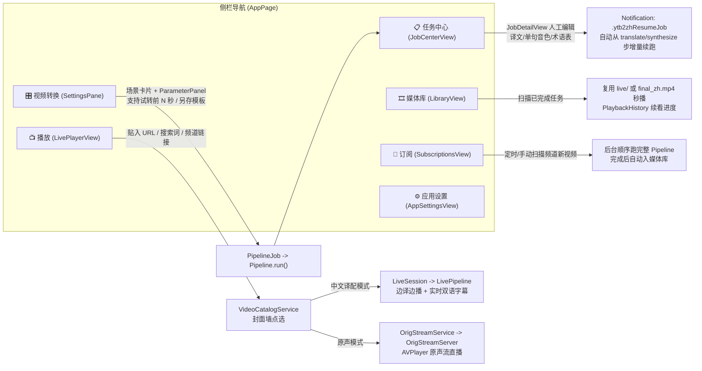

# 04. CLI、GUI 与二次开发指南（CLI, GUI & Development Guide）

本文档面向日常使用者、自动化脚本编写者以及准备为 `ytb2zh` 扩展新引擎的开发者（含 AI Agent），提供完整的命令行契约、GUI 状态流与插件开发指南。

---

## 1. 环境准备与源码构建

### 1.1 依赖清单
- **唯一必需外部工具**：`ffmpeg` 与 `ffprobe`（`brew install ffmpeg`）
- **原生内置（零外部安装）**：
  - `whisper.xcframework`（语音识别，Metal 加速）
  - `CDemucsCpp`（人声/伴奏分离，源码内编 + Accelerate BLAS）
  - `CSherpaOnnx`（离线中文 TTS，静态库内链）
  - `EdgeTTSEngine`（纯 Swift 直连微软免费 TTS）
  - `Videx`（纯 Swift 提取与下载 YouTube/B站/抖音/TikTok）
- **按需自动下载项**：
  - 推理权重（首次使用对应引擎时由 `ModelStore` 自动下载至 `~/.ytb2zh/models/`）：`ggml-base.en.bin`、`vits-zh-hf-theresa`、`ggml-model-htdemucs-4s-f16.bin`。
  - 备用 `yt-dlp`（仅当 `Videx` 提取失败时由 `YtDlpInstaller` 自动下载至 `~/.ytb2zh/bin/yt-dlp_macos`）。

### 1.2 构建与打包命令（`Makefile`）

```bash
# 1. 首次克隆后拉取 Frameworks/ 原生静态库与 xcframework（约 131MB）
./Scripts/bootstrap-deps.sh

# 2. 编译与测试
make build          # 调试构建 CLI (.build/debug/ytb2zh) 与 GUI (.build/debug/Ytb2ZHApp)
make release        # Release 优化构建
make test           # 运行全部单元测试（CoreTests + EnginesTests）
make verify         # 真机全链路自检（生成/使用 30s 素材跑通转录→切分→翻译→TTS→调度→成片）

# 3. 打包与运行 macOS App
make bundle         # 组装 .build/Ytb2ZH.app（拷入 whisper.framework、Support/*.lproj、AppIcon.icns）
make app            # 打包并后台启动 Ytb2ZH.app
make app-fg         # 前台启动 GUI（终端直接查看 stdout/stderr 日志）
```

---

## 2. CLI 命令参考与 JSON 事件流协议

CLI 入口位于 `Sources/ytb2zh/CLI.swift`，与 GUI 共享完全相同的 `Ytb2ZHCore` 与 `Ytb2ZHEngines` 内核。

### 2.1 常用命令速查

```bash
# 单视频完整译配（指定模板 + 动态覆盖任意嵌套参数）
ytb2zh run "https://www.youtube.com/watch?v=xxx" \
  --profile "精准对齐" \
  --set schedule.pauseMax=1.0 \
  --set synth.voice=longsanshu_v3.1

# 试转模式：只下载/截取前 180 秒跑全流程，低成本验证配置
ytb2zh run "https://www.youtube.com/watch?v=xxx" --trial-seconds 180

# 外部 SRT 字幕导入模式（跳过 Whisper 转录）
ytb2zh run ./local_video.mp4 --srt ./external_en.srt

# 断点续跑与增量重跑（例如人工修改了任务目录下的 translated.json 后，从合成步继续）
ytb2zh run "https://www.youtube.com/watch?v=xxx" --resume <jobID> --from synthesize
ytb2zh run "https://www.youtube.com/watch?v=xxx" --resume <jobID> --steps translate,synthesize,schedule,compose

# 批量任务（同 URL + 同 Profile 参数自动复用历史任务：done 跳过、failed 重试）
ytb2zh batch tasks.json

# 模板管理与引擎查询
ytb2zh templates list [--json]
ytb2zh templates save "我的科教模板" --base "研究级（术语+三步翻译）" --set engines.synthesize=edge-tts
ytb2zh templates delete "我的科教模板"
ytb2zh providers    # 列出九步所有已注册的引擎 ID 与说明
ytb2zh jobs         # 列出历史任务 ID、模板名与完成步数

# 专项探测工具
ytb2zh verify [--media ./sample.mp4]          # 逐引擎真机自检
ytb2zh orig-probe <url> [--proxy <proxy_url>] # 原声播放链路快验（解析→反代→m3u8/分片探测）
ytb2zh tts-probe                              # TTS 引擎可用性与延迟探测
```

### 2.2 标准输出 JSON 事件流契约
`ytb2zh run` 与 `ytb2zh batch` 在 `stdout` 输出严格的 **JSON Lines（每行一个 JSON 对象）**，供上层脚本或自动化 Agent 实时消费进度：

```json
{"event":"stepStarted","step":"download"}
{"event":"progress","step":"download"," msg":"下载 42%","pct":0.42}
{"event":"stepFinished","info":{"video":"/Users/.../source.mp4"},"step":"download"}
{"event":"stepStarted","step":"transcribe"}
{"event":"stepFinished","info":{"words":"418"},"step":"transcribe"}
{"event":"log","msg":"—— 试转模式：只处理前 180 秒 ——"}
{"event":"failed","error":"HTTP 401...","step":"translate"}
```

---

## 3. 内置六大场景模板对照

`Profile.builtins`（`Sources/Ytb2ZHCore/Profile.swift`）预置了 6 套针对不同视频类型的参数组合：

| 模板名称 | 静态属性 | 关键引擎与参数差异 | 适用场景 |
| :--- | :--- | :--- | :--- |
| **均衡（默认）** | `Profile.balanced` | `punct` + `gateway` (`singlePass`, `narrator`) + `bailian` + `drift` (`driftCap=1.2s`, `pauseMax=1.3s`, `slowMax=1.15`) | 通用科技、知识类视频首选 |
| **精准对齐** | `Profile.tightSync` | 收紧同步：`driftCap=0.8s`, `pauseMax=0.9s`, `slowMax=1.08` | 露脸口播、教程演示、访谈对话 |
| **从容解说** | `Profile.relaxed` | 放宽同步：`driftCap=2.0s`, `pauseMax=1.6s`, `slowMax=1.18`, `style=.narrator` | 纪录片、风景、叙事长视频 |
| **仅字幕（不配音）** | `Profile.subtitlesOnly` | `synthesize="none"`, `schedule="none"`, `keepOriginalAudio=true` | 只需中文字幕、保留英文原声，最快最省 |
| **研究级（术语+三步翻译）** | `Profile.studied` | `summarize="gateway-terms"`, `useTerminology=true`, `quality=.threePass` | 硬核学术讲座、专业技术分享 |
| **保留 BGM（人声分离）** | `Profile.keepBGM` | `separate="demucs"`, `compose.keepBGM=true` | 音乐背景浓厚、综艺、宣传片 |

---

## 4. SwiftUI GUI 架构与交互流

桌面端代码位于 `Sources/Ytb2ZHApp/`，通过 `NavigationSplitView` 组织为 6 个主页面：



### 国际化（i18n）与全局日志（`AppLog`）
- **国际化（`L10n.swift` & `Support/*.lproj`）**：开发语言为简体中文，`Support/zh-Hans.lproj/Localizable.strings` 与 `Support/en.lproj/Localizable.strings` 提供中英双语词条。SwiftUI 静态字面量自动查表，动态插值字符串使用 `L("...")` 辅助函数。
- **日志系统（`AppLog.swift`）**：进程内维护 2000 行环形缓冲区（分 `debug` / `info` / `warn` / `error` 四级），同时将任务级 `log.txt` 镜像至全局日志，并在 `warn`/`error` 级别同步写入系统 `NSLog`。

---

## 5. 如何新增一个自定义引擎（3 步扩展指南）

得益于 `Ytb2ZHCore` 的协议化设计，为任意步骤添加新引擎（例如新增一个自定义 TTS 或 ASR 引擎）只需 **3 步**，无需修改 `Pipeline` 或 GUI 布局：

### 第 1 步：在 `Sources/Ytb2ZHEngines/` 实现对应步骤协议
以新增语音合成引擎为例，实现 `SpeechSynthesisEngine`：

```swift
import Foundation
import Ytb2ZHCore

public struct MyCustomTTSEngine: SpeechSynthesisEngine {
    public let descriptor = EngineDescriptor(
        "my-tts", "我的自定义配音", "说明文字（将自动显示在 GUI 选择器与 CLI providers 中）"
    )

    /// 若引擎原生支持按 options.effectiveRate 合成目标语速，设为 true；
    /// 若设为 false，Pipeline 会自动通知 DriftScheduler 用 ffmpeg atempo 兜底变速。
    public var supportsRateControl: Bool { true }

    public init() {}

    public func synthesize(text: String, cacheKey: String, cacheDir: URL,
                           options: SynthOptions) async throws -> (url: URL, duration: Double) {
        let outURL = cacheDir.appendingPathComponent("\(cacheKey).mp3")
        // 1. 调用你的 API 或本地模型将 text 合成为音频写入 outURL（速率使用 options.effectiveRate）
        // 2. 用 ffprobeDuration(outURL) 探测时长并写入伴生文件 "\(cacheKey).duration"
        let dur = ffprobeDuration(outURL) ?? 1.0
        try? String(format: "%.3f", dur).write(
            to: cacheDir.appendingPathComponent("\(cacheKey).duration"),
            atomically: true, encoding: .utf8
        )
        return (outURL, dur)
    }
}
```

### 第 2 步：在 `EngineAssembly.swift` 注册并装配
打开 `Sources/Ytb2ZHEngines/EngineAssembly.swift`：
1. 在 `registry()` 对应步骤的 `descriptors` 数组中追加 `MyCustomTTSEngine().descriptor`；
2. 在 `engineSet(for:)` 的 `switch id(.synthesize, "bailian")` 中增加分支：
   ```swift
   case "my-tts": MyCustomTTSEngine()
   ```

### 第 3 步：（可选）在 `Profile.swift` 与 `ParameterPanel.swift` 添加专属配置项
- 若新引擎需要专属配置字段，在对应的 `Options` 结构体（如 `SynthOptions`）中添加属性，并在 `CodingKeys` 与 `init(from decoder:)` 中使用 `decodeIfPresent` 提供默认值（**切记保持旧模板 JSON 向后兼容**）。

---

## 6. 测试体系与质量门禁

项目拥有完善的离线单元测试与真机冒烟测试（位于 `Tests/` 与 `Videx/Tests/`）：

| 测试套件 | 位置 | 覆盖重点 |
| :--- | :--- | :--- |
| **`Ytb2ZHCoreTests`** | `Tests/Ytb2ZHCoreTests/CoreTests.swift` | `Profile` 编解码与旧版 JSON 向后兼容、`TemplateStore`、`JobStore` 状态流转、`ClauseTextSplitter` 三规则边界 |
| **`Ytb2ZHEnginesTests`** | `Tests/Ytb2ZHEnginesTests/EngineLogicTests.swift` | `PunctSegmentationEngine` 句界消歧与合并、`DriftSchedulerEngine` 漂移与停顿伸缩、`SRTBuilder` Netflix 单行硬切与双语字幕、`TranslateCore` 字数节奏判定 |
| | `Tests/Ytb2ZHEnginesTests/LivePipelineLogicTests.swift` | 直播 60s 切窗（`planWindows`）、EVENT HLS 播放列表生成 |
| | `Tests/Ytb2ZHEnginesTests/NativeEnginesTests.swift`<br/>`DemucsNativeTests.swift` / `EdgeTTSTests.swift` | `ModelStore` 路径解析、内嵌 Whisper / Sherpa-ONNX / Demucs.cpp / Edge-TTS 引擎契约 |
| | `Tests/Ytb2ZHEnginesTests/VidexBridgeTests.swift`<br/>`WebPoTokenTests.swift` / `OrigStream*Tests.swift` | `VidexBridge` 选流、WebPO 缓存作用域与注入、原声流本地反代服务 |
| **`VidexTests`** | `Videx/Tests/VidexTests/` | 四站点 URL 与响应解析、JSC 混淆挑战求解、TikTok WAF PoW、B站 WBI 黄金值、InnerTube 客户端矩阵与 POT 过滤、SABR/HLS/DASH 下载器 |

运行测试：
```bash
# 运行主包全部单测
swift test

# 运行 Videx 子包单测
cd Videx && swift test
```
