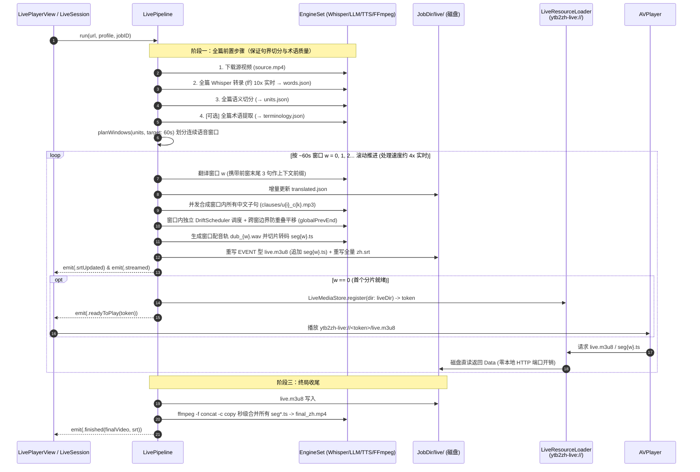
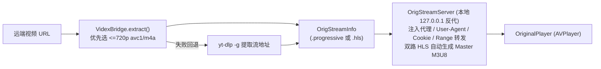
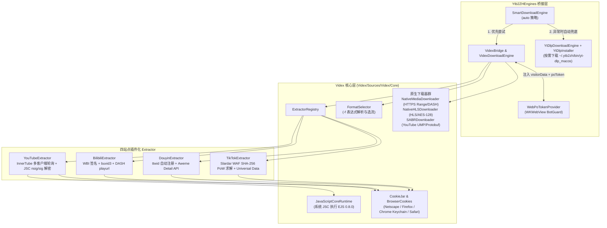
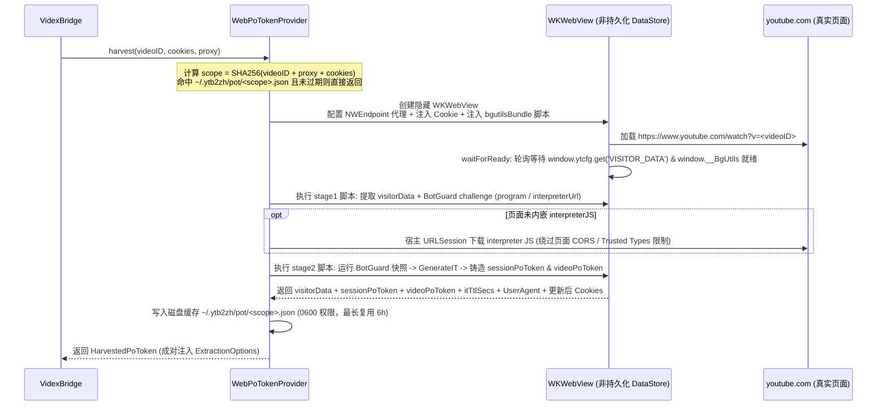

# 03. 实时伪直播与 Videx 提取引擎（Live Streaming & Videx）

本文档详解 `ytb2zh` 最具特色的两大子系统：**4x 实时追赶式伪直播播放器（`LivePipeline`）** 与 **纯 Swift 多站点提取/下载内核（`Videx` + `WebPoTokenProvider`）**。

---

## 1. 追赶式伪直播架构（`LivePipeline`）

传统视频配音必须等待全片翻译、TTS 合成与视频转码全部完成后才能观看（15 分钟视频往往需要等待数分钟）。`LivePipeline`（`Sources/Ytb2ZHEngines/LivePipeline.swift`）采用**「前置全篇切分 + 后置 60s 窗口滚动生成 EVENT HLS」**的混合架构，实现点击后数十秒即开播、边处理边观看：

### 核心工程设计细节
1. **为什么下载/转录/切分全篇执行，而后半程按 60s 窗口滚动？**
   - 本地 `whisper.xcframework`（Metal 加速）转录速度高达 **~10x 实时**，标点切分耗时 `< 10ms`；全篇切分能保证句子边界与术语表全局一致。
   - 真正的耗时大户是 LLM 翻译、网络 TTS 合成与 FFmpeg 视频重编码。将这三步按 `~60s` 窗口（`LivePipeline.planWindows`）滚动推进，首个 60 秒窗口仅需约 10–15 秒即可完成并开播，后续窗口以 **~4x 实时速度**持续跑在播放指针前方。
2. **跨窗口时间轴防碰撞平移**：
   - 每个窗口独立调用 `DriftSchedulerEngine.schedule()`，若当前窗口首条配音的起点 `first.at < globalPrevEnd + unitGap`，则将当前窗口所有 `placements` 与 `unitSchedules` 整体向后平移 `delta = globalPrevEnd + unitGap - first.at`，并确保分片终点 `segEnd = max(winEndNatural, globalPrevEnd + 0.3)`，绝不截断配音尾音。
3. **`ytb2zh-live://` 自定义 Scheme 零网络直读**：
   - GUI 播放器（`Sources/Ytb2ZHApp/LivePlayerView.swift` 中的 `LiveResourceLoader`）实现了 `AVAssetResourceLoaderDelegate`，拦截 `ytb2zh-live://<token>/live.m3u8` 与 `segNNN.ts`，直接从 `LiveMediaStore` 注册的本地磁盘目录读取字节喂给 `AVPlayer`，完全绕开本地 HTTP 端口与 ATS 限制（同时保留 `LiveHTTPServer` 供外部调试）。
4. **重播秒开与媒体库互通**：
   - 终局阶段将所有 `segNNN.ts` 通过 `ffmpeg -f concat -c copy` 无损拼接为 `final_zh.mp4`。再次播放同一任务时直接复用已有成片或 HLS 目录，实现零等待秒开。

---

## 2. 原声即播流服务（`OrigStreamService` & `OrigStreamServer`）

当用户在播放页切换到**「原声模式」**时，无需等待整片下载，即可直接流式观看远端原片：

- **為什麼需要本地反代 `OrigStreamServer`？**
  - `AVPlayer` 原生不支持为单次请求单独配置 HTTP/SOCKS 代理，也无法携带受保护的 `Cookie` 或处理分离的音视频双路 HLS。`OrigStreamServer`（`Sources/Ytb2ZHEngines/OrigStreamServer.swift`）在本地起轻量 HTTP 服务，代为通过代理请求远端 CDN、透传 `Range` 头，并在音视频分离的 HLS 场景下动态合成 `#EXT-X-MEDIA:TYPE=AUDIO` Master Playlist 交给 `AVPlayer`。

---

## 3. Videx 纯 Swift 视频提取与原生下载库

`Videx`（位于仓库 `Videx/` 目录）是专为本项目打造、亦可独立使用的纯 Swift 视频提取与下载包，支持 **YouTube、Bilibili、抖音、TikTok** 四大平台。

### 四大站点提取机制一览

| 站点 | 关键模块 (`Videx/Sources/Videx/`) | 核心提取与反爬机制 |
| :--- | :--- | :--- |
| **YouTube** | `YouTube/YouTubeExtractor.swift` `YouTube/InnerTubeClient.swift` `YouTube/NativeEJSSolver.swift` `YouTube/SABR/SABRDownloader.swift` | • **多客户端轮询**：未登录默认 `tv_samsung` → `visionos` → `web`；已登录（含 `LOGIN_INFO`+`SAPISID`）走 `web_embedded` → `tv_samsung` → `web`。 • **真引擎挑战求解**：使用 macOS 系统 `JavaScriptCore` 运行内置 `ejs-core.min.js` / `ejs-lib.min.js`，直接解密播放器 `sig` 与 `n` 参数。 • **GVS PO Token 策略**：自动过滤缺 POT 会 403 的格式，支持外部成对注入 `visitorData` + `poToken`。 • **原生 SABR / HLS / Range 下载**：支持断点续传与过期 URL 自动刷新，FFmpeg 仅做最终本地 `-c copy` 容器封装。 |
| **Bilibili** | `Bilibili/BilibiliExtractor.swift` `Bilibili/WBISigner.swift` | • 自动获取 `buvid3` 并通过 `WBISigner` 计算 `w_rid` / `wts` 签名。 • 解析 DASH 音视频分轨流与 JSON 字幕（自动转 SRT）；支持传入 `SESSDATA` Cookie 解锁高画质。 |
| **抖音 (Douyin)** | `Douyin/DouyinExtractor.swift` `Aweme/AwemeParser.swift` | • 自动向 `ttwid.bytedance.com` 注册会话 `ttwid` Cookie。 • 调用 `/aweme/v1/web/aweme/detail/` 获取 1080p H.264 无水印流，支持 `v.douyin.com` 短链跳转。 |
| **TikTok** | `TikTok/TikTokExtractor.swift` `TikTok/WAFChallenge.swift` | • **原生 WAF PoW 求解**：遇 Slardar WAF 挑战页时，使用 `CryptoKit` 在纯 Swift 中完成 SHA-256 碰撞求解（几十次迭代内命中），无需外部浏览器。 • 从 `__UNIVERSAL_DATA_FOR_REHYDRATION__` 提取 `aweme/v1/play/` 签名 CDN 流地址。 |

---

## 4. Web PO Token 原生收割器（`WebPoTokenProvider`）

当 YouTube 对当前网络出口触发严格风控、要求提供 GVS/Player Proof-of-Origin Token（PO Token）时，`WebPoTokenProvider`（`Sources/Ytb2ZHEngines/WebPoTokenProvider.swift`）利用 macOS 内置的 `WKWebView` 在真实浏览器环境中铸造令牌：

### 关键同步与安全约束
- **成对绑定（Session Parity）**：`poToken` 与生成它时的 `visitorData`、浏览器 `Cookie`、`User-Agent` 以及代理出口 IP 严格绑定。`VidexBridge.extractOnce` 会通过 `PoTokenSessionHTTPClient` 确保后续 InnerTube API 与媒体流请求使用完全一致的会话标识（详见 `Videx/PO-TOKEN-PARITY.md`）。
- **两级触发**：
  1. 提取前若开启了 `WebPotHarvestSetting.enabled`，优先读取或收割当前 `scope` 的令牌；
  2. 若走代理遇到风控错误（`loginRequired` / `notExtractable`），先尝试直连重试，仍失败则强制 `bypassThrottle = true` 重新拉起 `WKWebView` 收割新令牌再试一次。
