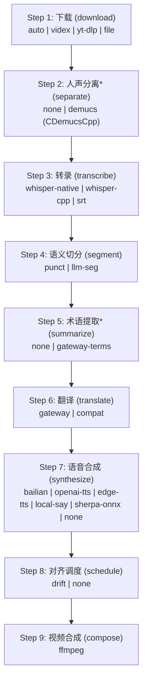
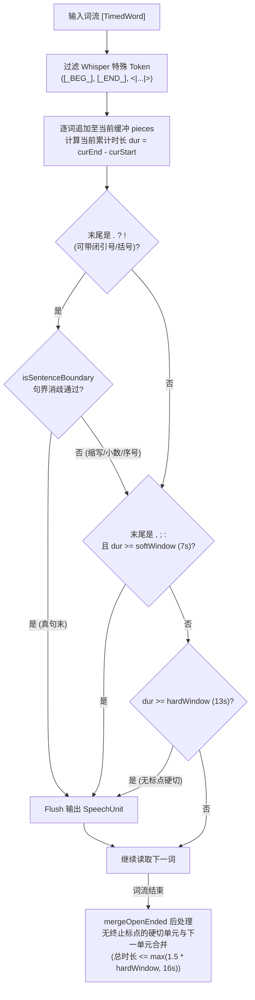
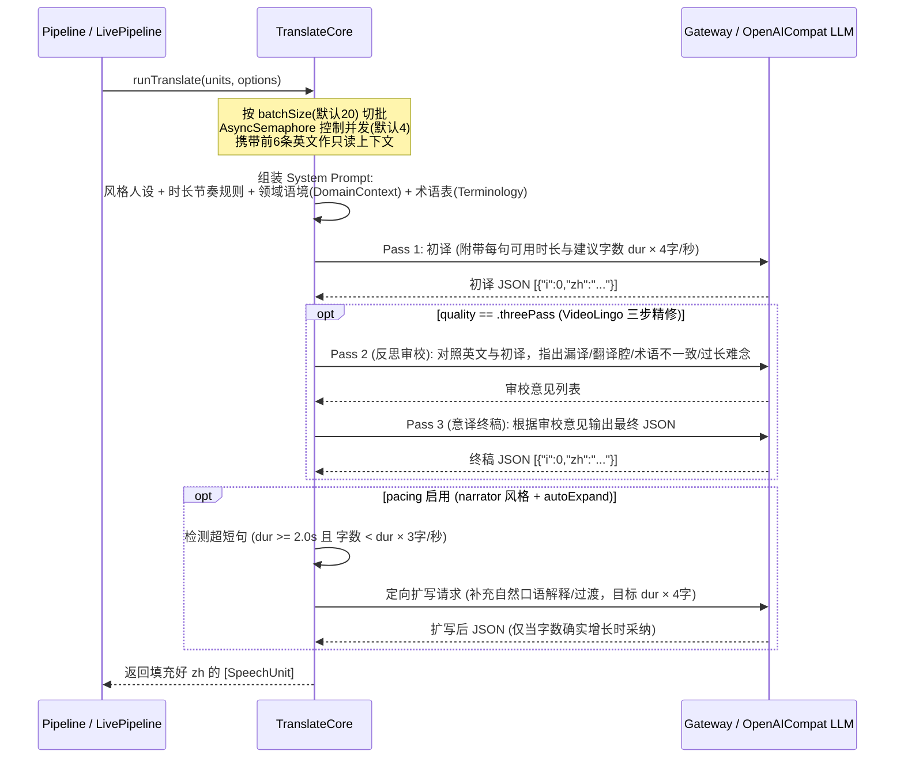
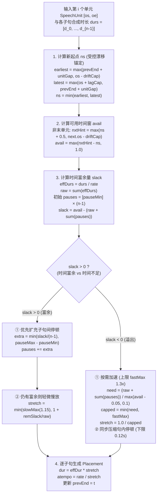

# 02. 九步译配管线与核心算法（Pipeline & Core Algorithms）

本文档深入解析 `ytb2zh` 九步管线的全部可选引擎实现，以及决定最终译配质量的四大核心算法：**英文句界消歧语义切分**、**三步翻译与双向字数节奏控制**、**中文子句连读拆分**与**漂移上限对齐调度（DriftScheduler）**。

---

## 1. 九步引擎全景矩阵

### 各步引擎实现对照表

| 步骤 (`StepID`) | 引擎 ID | 实现类与源文件 | 技术特点与适用场景 |
| :--- | :--- | :--- | :--- |
| **1. download** | `auto` (默认) | `SmartDownloadEngine` (`DownloadTranscribe.swift`) | 本地路径直导 → `Videx` 原生提取优先 → 失败自动按需下载 `yt-dlp` 兜底 |
| | `videx` | `VidexDownloadEngine` (`VidexBridge.swift`) | 纯 Swift 提取 YouTube/B站/抖音/TikTok，原生 Range/HLS/DASH/SABR 下载 |
| | `yt-dlp` | `YtDlpDownloadEngine` (`DownloadTranscribe.swift`) | 外部 `yt-dlp` sidecar（支持 `--download-sections` 试转截段） |
| | `file` | `FileImportEngine` (`FileDownloadEngines.swift`) | 导入本地视频文件 |
| **2. separate** | `none` (默认) | `NullVocalSeparator` (`NullEngines.swift`) | 不分离，直接用原音轨转录 |
| | `demucs` | `NativeDemucsSeparator` (`DemucsVocalSeparator.swift`) | 进程内运行 `demucs.cpp`（`htdemucs` 4源模型），产出 `vocals.wav`（提质转录）与 `instrumental.wav`（保留 BGM） |
| **3. transcribe** | `whisper-native` (默认) | `NativeWhisperEngine` (`NativeWhisperEngine.swift`) | 内嵌 `whisper.xcframework`（Metal/CoreML 加速），提取 DTW/token 词级时间戳，模型自动下载至 `~/.ytb2zh/models/` |
| | `whisper-cpp` | `WhisperCliEngine` (`DownloadTranscribe.swift`) | 调用外部 `whisper-cli` 二进制（向后兼容） |
| | `srt` | `SrtTranscribeEngine` (`SrtImportEngine.swift`) | 导入外部 `.srt` 字幕，按句均匀切分伪词级时间戳，跳过语音识别 |
| **4. segment** | `punct` (默认) | `PunctSegmentationEngine` (`PunctSegmentationEngine.swift`) | 纯算法：词级时间戳上按英文句末标点、软硬时间窗与句界消歧重组 |
| | `llm-seg` | `LLMSegmentationEngine` (`LLMSegmentationEngine.swift`) | 先跑 `punct` 粗切，再交由 LLM 按完整语义合并/重切 |
| **5. summarize** | `none` (默认) | `NullTerminologyEngine` (`NullEngines.swift`) | 跳过术语提取 |
| | `gateway-terms` | `GatewayTerminologyEngine` (`TerminologyEngines.swift`) | LLM 全文扫描提取 `DomainContext`（领域/语气/受众）与专业术语表（`terminology.json`） |
| **6. translate** | `gateway` (默认) | `GatewayTranslateEngine` (`GatewayTranslateEngine.swift`) | 对接本地或远端 Responses API（`/v1/responses`） |
| | `compat` | `OpenAICompatTranslateEngine` (`OpenAICompatTranslateEngine.swift`) | 对接任意 OpenAI 兼容 `/v1/chat/completions` 接口 |
| **7. synthesize** | `bailian` (默认) | `BailianSynthEngine` (`BailianSynthEngine.swift`) | 阿里云百炼 `qwen-audio` / CosyVoice WebSocket 合成，支持原生 `rate` 变速 |
| | `openai-tts` | `OpenAITTSEngine` (`AlternateTTSEngines.swift`) | OpenAI 兼容 `/v1/audio/speech` 接口，支持原生 `speed` 变速 |
| | `edge-tts` | `EdgeTTSEngine` (`EdgeTTSSwift.swift`) | 纯 Swift WebSocket 直连微软 Edge 免费语音，SSML `prosody rate` 原生变速 |
| | `local-say` | `LocalSayTTSEngine` (`LocalTTSEngines.swift`) | macOS 系统内置 `say` 命令，`say -r` 原生变速，零网络依赖 |
| | `sherpa-onnx` | `SherpaOnnxTTSEngine` (`LocalTTSEngines.swift`) | 内嵌 `CSherpaOnnx` 离线中文 VITS（`vits-zh-hf-theresa` 自动下载），支持原生变速 |
| | `none` | `NullSynthEngine` (`NullEngines.swift`) | 纯字幕模式跳过配音 |
| **8. schedule** | `drift` (默认) | `DriftSchedulerEngine` (`DriftSchedulerEngine.swift`) | 漂移上限对齐调度算法（控制提前/落后上限、扩停顿、语速拉伸） |
| | `none` | `NullSchedulerEngine` (`NullEngines.swift`) | 纯字幕模式按原始时间戳 1:1 映射 `UnitSchedule` |
| **9. compose** | `ffmpeg` (默认) | `FFmpegComposeEngine` (`FFmpegComposeEngine.swift`) | 配音轨拼接 + `SRTBuilder` 字幕生成 + 原声闪避/BGM 混音 + 硬字幕烧录 |

---

## 2. 语义切分算法（`PunctSegmentationEngine`）

Whisper 等 ASR 模型原生输出的 segment 中有约 **96% 是半句话**，若直接逐行翻译会导致语序破碎、翻译腔严重。`PunctSegmentationEngine`（`Sources/Ytb2ZHEngines/PunctSegmentationEngine.swift`）在词级时间戳（`[TimedWord]`）上按英文句读与时间窗重组为完整语义单元（`[SpeechUnit]`）：

### 句界消歧规则（`isSentenceBoundary`）
当遇到 `.` 结尾的词时，满足以下任一条件**不视为句末**（防止一句完整英文被拦腰切断）：
1. **下一词首字母小写**：大概率是缩写或编号后的正常接续（`?` 和 `!` 不受此限，永远收句）。
2. **纯数字编号**：如 `"1."`、`"3."`。
3. **单字母首字母缩写**：如人名中间名 `"J."`。
4. **内部含句点的缩写链**：如 `"U.S."`、`"e.g."`、`"Ph.D."`。
5. **常见缩写白名单（60+ 词）**：如 `mr`, `dr`, `prof`, `vs`, `etc`, `inc`, `fig`, `jan`..`dec` 等。

---

## 3. 翻译核心：三步精修与双向字数节奏（`TranslateCore`）

`TranslateCore`（`Sources/Ytb2ZHEngines/TranslateCore.swift`）将具体 LLM 通信抽象为 `Complete = (String, String) async throws -> String`，集中实现了所有翻译质量策略：

---

## 4. 中文子句智能拆分（`ClauseTextSplitter`）

在进入 TTS 合成与对齐调度前，`ClauseTextSplitter`（`Sources/Ytb2ZHCore/Pipeline.swift`）会将每条 `SpeechUnit.zh` 按 `，；、` 拆分为子句，使**句内停顿成为调度器可自由伸缩的参数**。为避免过度切分导致 TTS 机械断句，遵循三条连读保护规则：

1. **规则① 短句不拆**：整句去标点后总字数 `<= 16` 字（约 4 秒语音内）时，保持整句单条合成，保证连读自然度。
2. **规则② 贪心凑整**：从左到右扫描子句，若当前累积字数 `< 8` 字，则强制将下一子句并入当前子句。
3. **规则③ 孤儿尾句并入**：若最后一条子句去标点 `< 5` 字，直接并入倒数第二条子句。

---

## 5. 漂移上限对齐调度算法（`DriftSchedulerEngine`）

中英文语序和音节密度天然不同，若强行让每句中文严格卡在原英文起止时间内，会导致忽快忽慢的畸变听感。`DriftSchedulerEngine`（`Sources/Ytb2ZHEngines/DriftSchedulerEngine.swift`）允许配音在受控范围内温和漂移，并优先用句内停顿吸收时长偏差：

### 核心公式与默认参数（`ScheduleOptions`）
- **新起点计算**：
  $$\text{ns} = \min\Big(\max(\text{prevEnd} + \text{unitGap},\; \text{os} - \text{driftCap}),\; \max(\text{os} + \text{lagCap},\; \text{prevEnd} + \text{unitGap})\Big)$$
  - `driftCap = 1.2s`：配音最多比原画面提前 1.2 秒开念；
  - `lagCap = 0.8s`：配音最多比原画面落后 0.8 秒（若上一句严重溢出，优先保证不重叠 `prevEnd + unitGap`）；
  - `unitGap = 0.25s`：相邻语义单元之间的最小呼吸间隔。
- **停顿与变速优先级**：
  - 句内子句停顿范围：`[pauseMin, pauseMax] = [0.25s, 1.3s]`；
  - 慢放上限：`slowMax = 1.15`（最多拉长 15%）；
  - 加速上限：`fastMax = 1.30`（最多加速至 1.3x）；
  - 微小抖动死区：当 `|stretch - 1.0| <= 0.01` 时强制归 `1.0`，避免无意义的 `atempo` 重编码。

---

## 6. 视频合成、混音与 Netflix 字幕生成（`FFmpegComposeEngine`）

`FFmpegComposeEngine`（`Sources/Ytb2ZHEngines/FFmpegComposeEngine.swift`）负责将调度结果装配为最终视频：

### 6.1 Netflix 单行字幕切分（`SRTBuilder`）
- **对齐新时间轴**：字幕时间戳严格使用调度后的 `[UnitSchedule.newStart, UnitSchedule.newEnd]`，确保字幕与中文配音严丝合缝。
- **两级切分**：
  1. 先按时长（每 7.5s）与偏好行长 `preferred = maxLength / subtitleTargetMultiplier` 在中文标点 `，。！？；、` 处自然切分，并按字数比例分配时间；
  2. 若单条仍超过 `subtitleMaxLength`（默认 75），调用 `hardSplit` 在等分点附近 `±6` 字窗口寻找标点二次硬切。
- **双语模式（`bilingualSubtitles`）**：开启时英文原文在上、中文译文在下。

### 6.2 三种音轨合成模式
1. **纯中文配音（默认）**：`[1:a]volume={dubGainDB}dB,alimiter=limit=0.95[aout]`，直接替换原片音轨。
2. **保留 BGM 模式（`keepBGM = true` 且存在 `instrumental.wav`）**：
   - 将 Demucs 分离出的纯净伴奏轨 `instrumental.wav` 按 `bgmGainDB`（默认 `-3dB`）与中文配音轨 `amix` 混音，实现**人声完全替换为中文、背景音乐原汁原味保留**。
3. **原声闪避混音模式（`keepOriginalAudio = true` 且未分离人声）**：
   - 将原视频音轨压低 `-originalDuckRatio dB`（默认 `-6dB`）后与中文配音混音。
