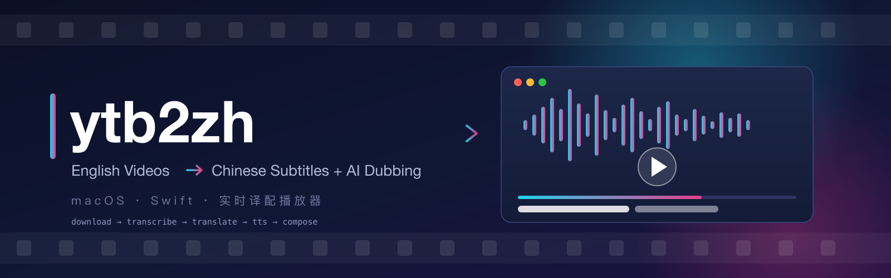

<div align="center">



# ytb2zh

**英文视频 → 中文字幕 + 中文配音** 的 macOS 客户端，
以及一个「边处理边播放」的实时中文配音播放器（伪直播模式）。


[快速开始](#依赖需自行准备) · [实时播放器](#实时播放器追赶式伪直播) · [CLI 用法](#cli) · [GUI](#gui) · [从源码构建](#从源码构建)

</div>

---

Swift 单语言实现，视频/元数据提取用内置 Videx 纯 Swift 库（YouTube/B站/抖音/TikTok），其余外部能力（whisper.cpp / ffmpeg / edge-tts / demucs）以 sidecar 接入，每一步都是协议化可插拔引擎；yt-dlp 仅作为备用（内置提取失败时才按需自动下载并切换使用，默认零依赖）。

架构源自 vid2zh 管线（`~/vid2zh`，Python 原型，已验证全片效果），本仓库是工程化客户端版本。功能吸收自 VideoLingo / pyVideoTrans 的评估结论（术语表、三步翻译、Netflix 字幕标准、多通道引擎、批量任务、断点编辑等）。

## 核心特性

- 🎬 **一站式译配**：下载 → 转录 → 语义切分 → 翻译 → 配音 → 成片，九步管线全自动，每步产物落盘可断点续跑、可人工修订后从任意步重跑。
- 📡 **实时伪直播**：处理约 4x 实时，边处理边用 AVPlayer 看——HLS 分片滚动推进、双语字幕同步、seek 回看已配音区间。
- 🧩 **协议化引擎**：九步各自对应一个 Swift 协议，换引擎 = 实现协议 + 注册一行；本地 whisper.cpp / demucs.cpp / sherpa-onnx / edge-tts 内置直连，默认零外部依赖。
- 🌐 **内置 Videx 提取**：纯 Swift 实现 YouTube / B站 / 抖音 / TikTok 的视频与元数据提取、搜索、频道浏览；yt-dlp 仅作按需兑底。
- 📖 **翻译质量**：术语表统一译法、三步翻译（直译→反思→意译）、领域感知 prompt、Netflix 单行字幕标准、中文配音时长自适应。
- 🖥 **完整 GUI**：封面墙搜索/媒体库/订阅预翻译/任务中心（译文与术语编辑器）/参数面板，CLI 与 GUI 共享同一引擎内核。

## 实时播放器（追赶式伪直播）

GUI 右上角"实时播放"：贴 URL 或在搜索栏点选封面，处理到哪看到哪——

- **模型**：下载/转录/切分全篇执行（保证语义切分质量，产物与批量任务互通），翻译→合成→调度→配音轨→分片按 ~60s 语音窗口滚动推进；每窗口产出 MPEG-TS 分片并追加进 EVENT 型 HLS 播放列表，AVPlayer 以"直播流"形式消费。处理速度约 4x 实时，始终跑在播放前面，seek 可回看任意已配音区间。
- **播放通道**：不走本地 HTTP——AVAssetResourceLoaderDelegate + 自定义 scheme `ytb2zh-live://<token>/live.m3u8` 磁盘直读分片，零 ATS 风险。
- **实时双语字幕**：每窗口增量重写 SRT，播放器按 0.25s 轮询同步显示当前字幕（双语随 Profile）。
- **重播秒开**：同 URL + 同 Profile 的已完成任务直接复用已生成的直播目录与成片，零等待开播。
- **搜索浏览**：搜索取数（关键词 / 频道页 / 播放列表 URL 通用），封面墙点选即播（Videx InnerTube 原生实现，零外部依赖；内置失效或非 YouTube 站点时回退备用 yt-dlp）。
- **媒体库**：所有已产出成片的任务（直播或批量）在"媒体库"封面墙里一键秒播，优先复用直播目录，无则成片直读；Profile 自动取任务派生参数快照（`JobStore.loadProfileSnapshot`）。
- **订阅预翻译**："订阅"里添加频道/播放列表，点"预翻译"自动扫最新视频、跳过已在库的，按序后台跑完整批量管线；完成即入媒体库随时秒播。未完成任务自动断点续跑。
- **终局产物**：`#EXT-X-ENDLIST` + SRT + concat 成片 `final_zh.mp4`，与批量管线产物同构。

## 管线（九步，可选步默认关闭）

```
下载 → 人声分离* → 转录 → 语义切分 → 术语提取* → 翻译 → 语音合成 → 对齐调度 → 视频合成
auto    demucs*   whisper  punct/LLM  gateway-terms*  LLM    百炼/兼容/Edge  漂移调度   ffmpeg
```

带 * 的为可选步（Profile 里 engines 选 `none` 跳过）。每步对应一个协议（`Ytb2ZHCore/EngineProtocols.swift`），实现集中在 `Ytb2ZHEngines/`，通过 `EngineAssembly.registry()` 注册，Profile 里按步选择引擎 id。换引擎 = 实现协议 + 注册一行，其余完全不感知。

各步引擎一览（`ytb2zh providers`）：

| 步骤 | 引擎 |
| --- | --- |
| download | `auto`（Videx 原生优先、内置失败时按需下载 yt-dlp 兑底、本地路径→导入）、`videx`、`yt-dlp`、`file` |
| separate | `none`、`demucs`（人声/伴奏分离，demucs.cpp 进程内推理，权重自动下载） |
| transcribe | `whisper-cpp`（本地词级时间戳）、`srt`（外部 SRT 导入） |
| segment | `punct`（标点规则切分）、`llm-seg`（punct 粗切 + LLM 重组） |
| summarize | `none`、`gateway-terms`（LLM 术语提取 → terminology.json，可人工修订） |
| translate | `gateway`（Responses API）、`compat`（任意 OpenAI 兼容 chat/completions） |
| synthesize | `bailian`（qwen-audio WS）、`openai-tts`（/v1/audio/speech）、`edge-tts`（免费微软语音）、`none` |
| schedule | `drift`（漂移上限调度）、`none` |
| compose | `ffmpeg` |

关键设计（继承 vid2zh 实测经验）：

- **语义切分**：whisper 原生分段 96% 是半句，改为在词级时间戳上按英文句读重组——句末标点必收、逗号处累计 ≥7s 收、13s 强制收；`llm-seg` 再让 LLM 按完整语义重组。
- **对齐调度**（`DriftSchedulerEngine`，纯算法）：中文按 `，；、` 切子句逐条合成，使停顿成为可调参数；排布 `ns = max(prev_end + gap, os − driftCap)` 再钳到 `os + lagCap`（配音最多领先/落后画面各 1.2s / 0.8s）；富余时间先扩子句停顿（0.25–1.3s）再慢放（≤15%），不足则加速（≤1.3x）。
- **术语表**：翻译前 LLM 扫全文抽取领域术语（落盘 `terminology.json`），注入翻译 prompt 强制统一译法；GUI/CLI 均可人工修订后从翻译步续跑。
- **三步翻译**（VideoLingo 三步法）：直译 → 反思审校 → 意译终稿，`translate.quality=threePass` 开启；`singlePass` 直出。
- **Netflix 单行字幕标准**：`compose.subtitleMaxLength`（默认 75）超长行按标点二次硬切，`subtitleTargetMultiplier` 控制行长偏置；`compose.bilingualSubtitles` 中英双语。
- **BGM 保留**：`demucs` 分离出伴奏后 `compose.keepBGM` 混入（人声已换、伴奏保留）；不分离时可用 `keepOriginalAudio` 原声闪避。
- **多角色配音**：`SpeechUnit.voice` 支持按单元覆盖音色（GUI 译文编辑器里逐单元设置）。
- **翻译 prompt**：强制中文语序重组织 + 口语解说风（三种风格可切换），杜绝翻译腔。
- **断点续跑**：每步产物落盘（`~/Library/Application Support/Ytb2ZH/Jobs/<id>/`，含 profile.json 快照），失败重跑自动跳过已完成步骤；翻译/合成幂等缓存。
- **模板向后兼容**：旧版（七步、缺新字段）模板 JSON 与用户模板均可正常加载，缺省自动补默认值。

## 国际化（i18n）

界面以简体中文为开发语言，内置英文翻译（`Support/zh-Hans.lproj` / `Support/en.lproj`，约 400 条）：

- SwiftUI 字面量（`Text` / `Button` / `.help` / `Section` 等）自动查表，无需改代码；动态拼接串经 `L()` / `L10n.tr()` 帮助层查表。
- 切换语言：「应用设置 → 通用 → 界面语言」（跟随系统 / 简体中文 / English），写入 `AppleLanguages` 后重启生效（界面内提供「立即重启」）。
- CLI 输出（JSON 事件流/人类可读文本）保持中文，不属于本机制；管线日志（`log.txt`）同样保持中文原文。
- 打包时 `make bundle` 会自动把 `Support/*.lproj` 拷入 `Contents/Resources/`。

## 日志系统

- **全局日志**（`AppLog`）：进程内环形缓冲（最近 2000 行，debug/info/warn/error 四级 + 类别标签），入口在「应用设置 → 通用 → 运行日志 → 查看应用日志…」，支持按级别过滤、清空、复制、导出 txt。
- **管线日志**：沿用任务目录 `log.txt`（跨续跑追加），同时镜像进全局日志，任务详情页看单任务、全局面板看时间线。
- **系统日志**：warn/error 同步镜像到 NSLog（Console.app 可搜 `ytb2zh`），便于用户反馈时抓取。
- CLI 的 stdout JSON 是接口契约，不走全局日志。

## 图标与品牌资源

- 应用图标：`make icon`（Tools/make_icon.sh：SVG → 1024px PNG → iconutil → Assets/AppIcon.icns），`make bundle` 打包时自动拷入（Info.plist 已配 CFBundleIconFile）
- README 横幅：`Assets/banner.svg`（源文件）→ `Assets/banner.png`，重生成：`rsvg-convert -w 1600 -h 500 Assets/banner.svg -o Assets/banner.png`

## 布局

```
Sources/Ytb2ZHCore/      模型、九步协议、Profile/模板、JobStore、Pipeline 编排（无引擎依赖）
Sources/Ytb2ZHEngines/   引擎实现（sidecar 包装 / API 客户端 / 纯算法）+ LivePipeline 直播管线 + VideoCatalogService
Sources/ytb2zh/          CLI：run / batch / templates / providers / jobs / verify
Sources/Ytb2ZHApp/       SwiftUI GUI（参数面板 + 任务中心 + 实时播放器）
Tests/                   单测（调度器 fixture / 切分 / SRT / Netflix 字幕 / 三步翻译 / 模板兼容 / JobStore / 直播切窗与 playlist / 目录解析）
```

## 依赖（需自行准备）

- ffmpeg / ffprobe：`brew install ffmpeg`
- yt-dlp：默认不安装。内置 Videx 提取失败时自动从官方 Releases 下载到 `~/.ytb2zh/bin/yt-dlp_macos`（也可自行放入该目录或加入 PATH）
- 网关 LLM：`http://127.0.0.1:15000/v1/responses`（Responses API）
- 百炼：在 Profile 中配置 `synth.apiKey`；默认 Profile 不包含 API Key（WS 地址仍有默认值）

内嵌引擎（无需安装）：whisper.cpp（Metal 加速）、edge-tts（纯 Swift 直连微软端点）、sherpa-onnx 离线 TTS、demucs.cpp 人声分离——权重（whisper ggml / sherpa vits / demucs htdemucs，首次使用时自动下载到 `~/.ytb2zh/models/`）。

## 从源码构建

原生依赖 whisper.xcframework / sherpa-onnx 静态库（约 131MB）不进 git，clone 后先执行：

```bash
./Scripts/bootstrap-deps.sh   # 从官方 Releases 下载并重建 Frameworks/
swift build                   # 或 make build
```

whisper 转录模型默认从 HuggingFace 下载 `ggml-base.en`；本地已有模型可在应用设置 → 模型提供者里配置路径。


## CLI

```bash
ytb2zh run https://www.youtube.com/watch?v=xxx --profile 精准对齐 \
    --set schedule.pauseMax=1.0 --set synth.voice=longsanshu_v3.1
ytb2zh run 本地视频.mp4 --srt 外挂.srt      # SRT 导入模式（跳过语音识别）
ytb2zh run <url> --resume <jobID> --steps translate   # 改完产物后单步重跑
ytb2zh batch tasks.json                    # 批量任务（同 URL+同参数复用任务：done 跳过、failed 重试）
ytb2zh templates list|save|delete          # 模板：派生起点 + 保存调整
ytb2zh providers                           # 九步可选引擎
ytb2zh jobs                                # 历史任务列表
ytb2zh verify                              # 逐引擎真机自检（30s 素材）
```

`tasks.json` 格式（数组或单对象；`set` 的值一律写字符串）：

```json
[
  {"url": "https://...", "profile": "均衡（默认）",
   "srt": null, "set": {"engines.synthesize": "edge-tts", "translate.quality": "threePass"}}
]
```

`run`/`batch` 输出 JSON 事件流（每行一个）：`stepStarted / progress / stepFinished / failed`，便于脚本消费。

内置模板六个：均衡（默认）/ 精准对齐 / 从容解说 / 仅字幕 / 研究级（术语+三步翻译）/ 保留 BGM（人声分离）。

## GUI

```bash
make app
```

左侧模板列表点按载入为派生起点；右侧参数面板全部是滑杆、步进器、选择器——漂移上限、停顿范围、语速倍率、音色、字号、单行字数上限、双语字幕、术语开关、翻译质量、目标语言等无手输；调整后可另存为用户模板（Application Support/Ytb2ZH/Templates）。运行时显示九步进度条。

任务中心：历史任务列表（完成度 / 失败标记）、一键断点续跑、译文编辑器（改中文译文与逐单元音色）、术语表编辑器（增删改术语），保存后自动从翻译步续跑。

## 开发

```bash
make build && make test   # 单测（调度器 fixture / 切分 / SRT / Netflix 字幕 / 三步翻译 / 模板兼容 / JobStore / 直播切窗与 playlist / 目录解析 / 流服务）
make verify               # 真机自检：转录→切分→翻译→TTS→调度→成片
make bundle               # 打包 .app（含 i18n 资源与图标）
```

新增引擎三步：实现协议 → `EngineAssembly.registry()` 注册 → Profile 里选用。

## 致谢

本项目站在众多开源项目的肩膀上，感谢它们：

- [yt-dlp](https://github.com/yt-dlp/yt-dlp) —— 备用下载与搜索兑底（内置 Videx 提取/搜索失效或非 YouTube 站点时按需自动下载使用）
- [whisper.cpp](https://github.com/ggerganov/whisper.cpp) —— 高性能本地词级时间戳语音识别（转录步）
- [FFmpeg](https://ffmpeg.org) —— 转码、混音、字幕烧录、成片合成（合成步 / MediaCompat）
- [Demucs](https://github.com/adefossez/demucs) —— 人声/伴奏分离，让保留 BGM 的中文配音成为可能（人声分离步）
- [edge-tts](https://github.com/rany2/edge-tts) —— 免费的微软 Edge 在线语音合成（可选配音引擎）
- [sherpa-onnx](https://github.com/k2-fsa/sherpa-onnx) —— 离线本地 TTS（可选配音引擎）
- [VideoLingo](https://github.com/Huanshere/VideoLingo) —— 术语表、三步翻译、Netflix 字幕标准等理念参考
- [pyVideoTrans](https://github.com/jianchang512/pyvideotrans) —— 多通道引擎与批量任务等产品形态参考
- [vid2zh](https://github.com/vid2zh) —— 本项目架构源自其 Python 原型管线（九步流程、漂移调度算法、实测经验）

以及所有未被列出但同样重要的上游生态（百炼 / OpenAI 兼容 API 的模型服务方、SwiftUI / Network.framework 等系统框架）。

## 许可证

本项目源码以 MIT 许可证分发，详见 [LICENSE](LICENSE)。

内嵌与运行时使用的第三方组件遵循其各自许可证（Eigen MPL-2.0、demucs.cpp / whisper.cpp / Demucs MIT、sherpa-onnx Apache-2.0 等），完整清单与合规说明（含 sherpa-onnx TTS 链接 espeak-ng 的 GPL-3.0 注意事项）见 [THIRD-PARTY-NOTICES.md](THIRD-PARTY-NOTICES.md)。仅以源码形式分发/使用时，MIT 即为全部所需。
